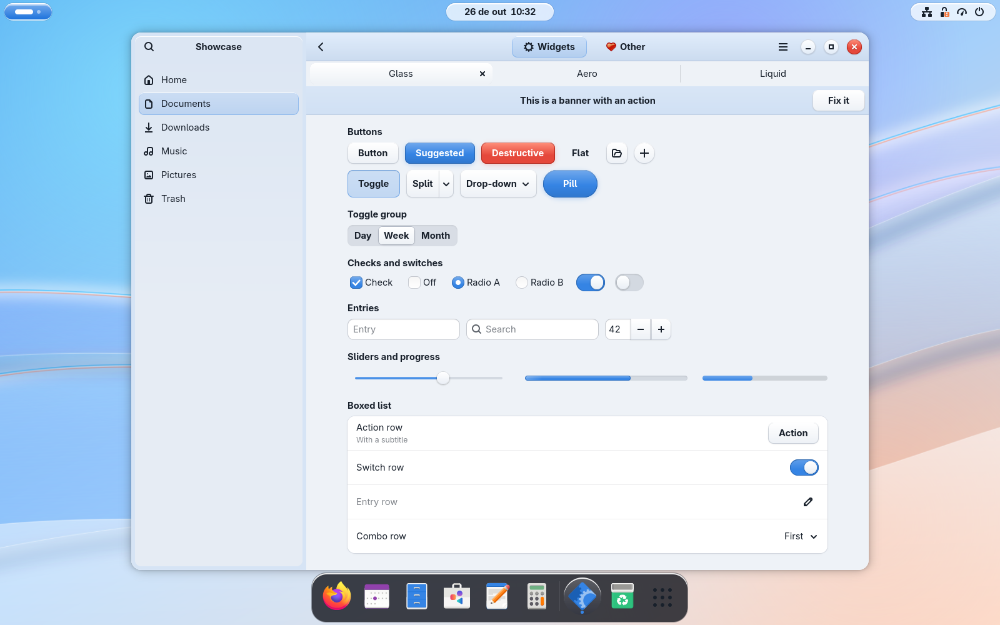
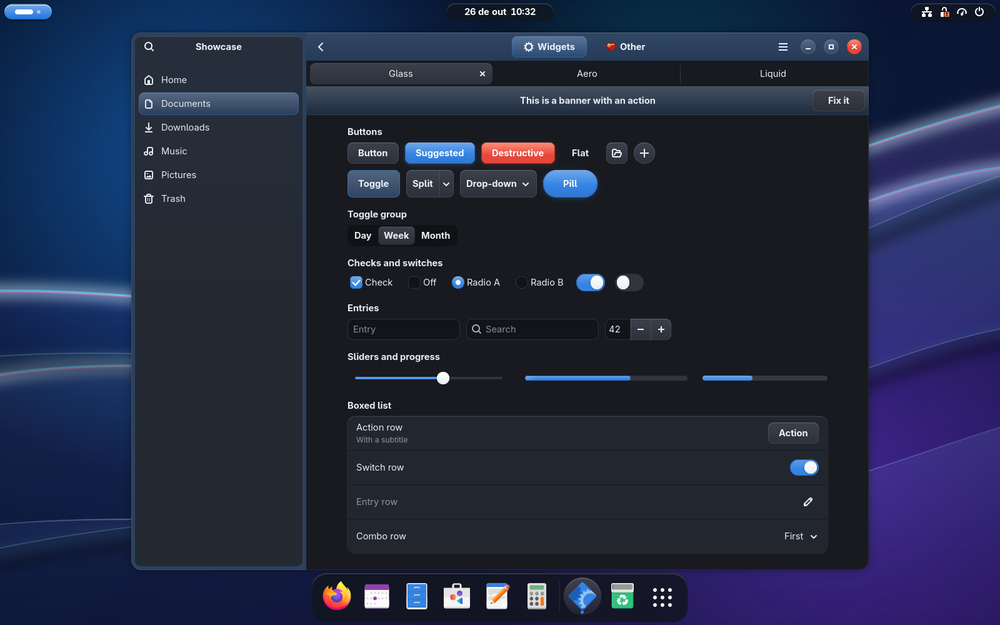
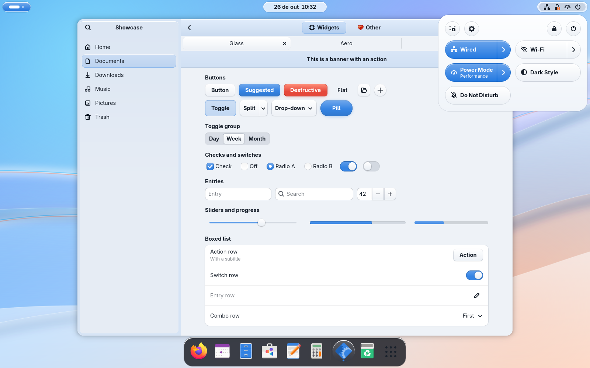
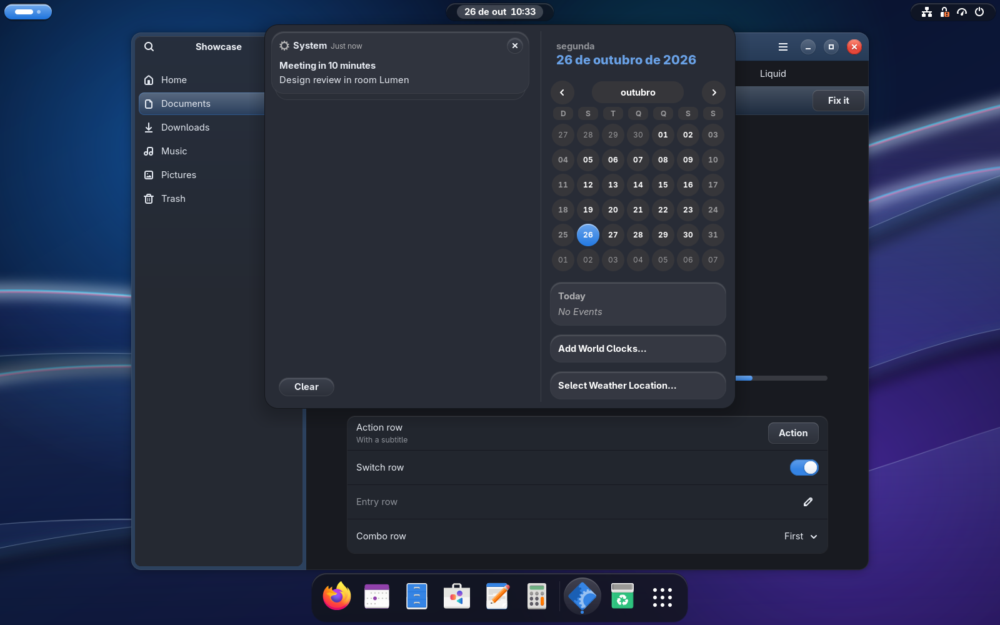
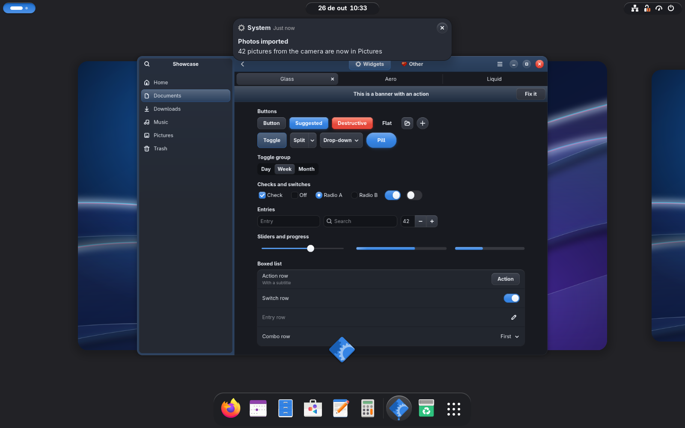
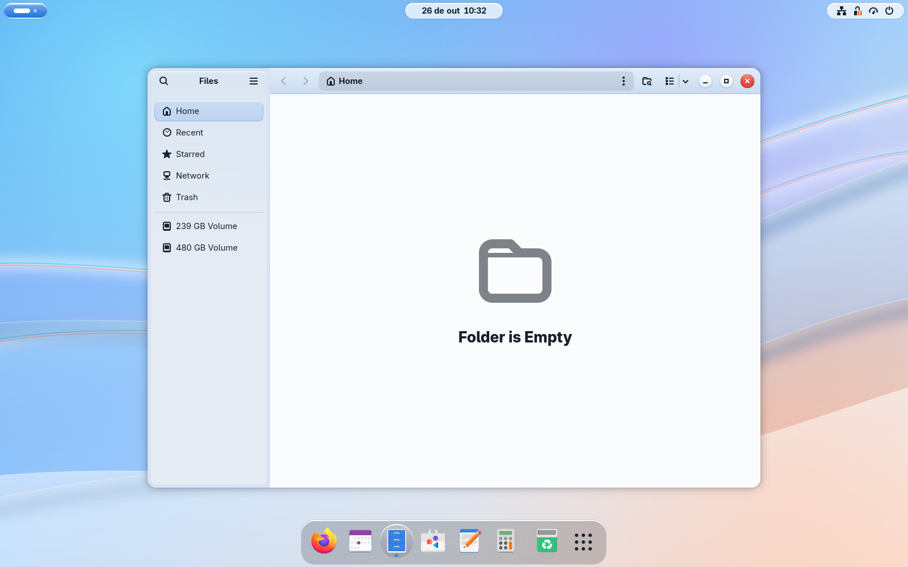
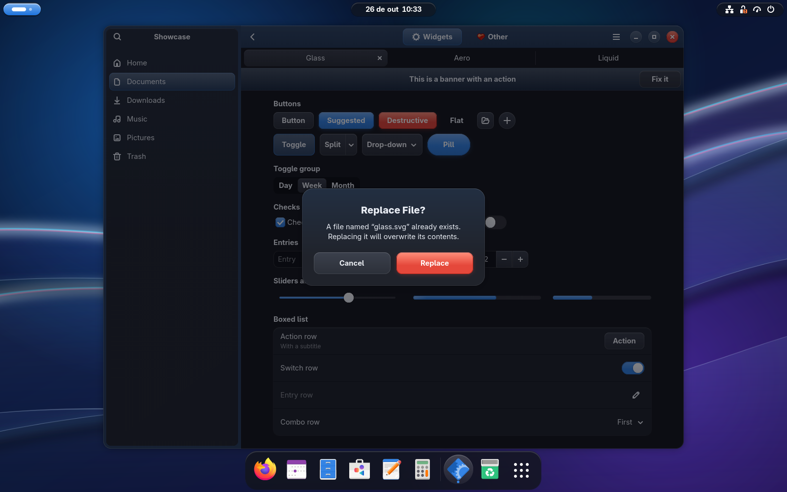
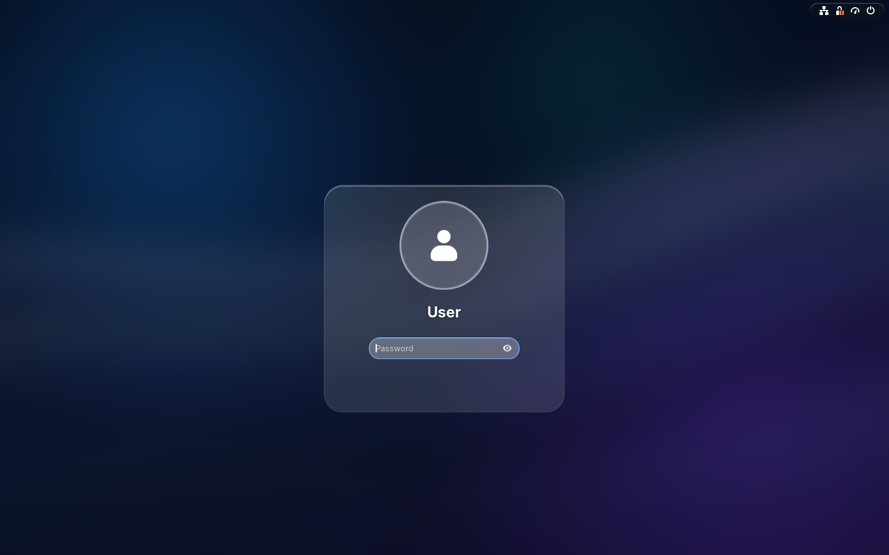
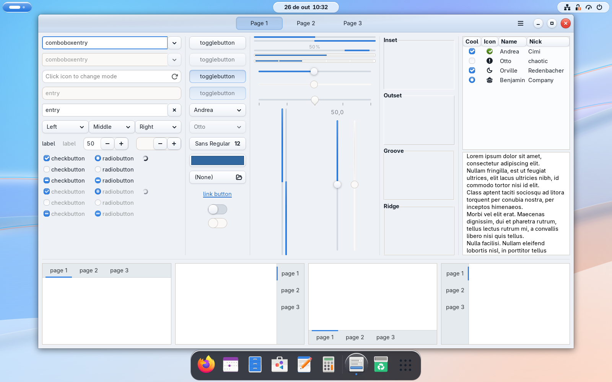
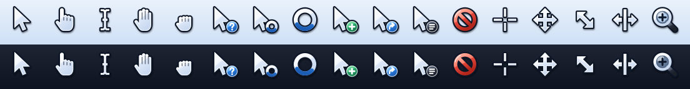

# GNOME Glass

A glass theme for **GNOME 50+**, inspired by Windows Aero and Apple's Liquid Glass but with a look
of its own: floating islands of glass in the top bar, title bars tinted with your accent color, a
floating sidebar, window controls shaped like glass orbs, and light that comes from below when you
hover. Frosted glass by day, smoked glass by night.

**Version 1.1.0** · [changelog](CHANGELOG.md)



| Dark mode | Quick settings |
|---|---|
|  |  |

| Calendar and notifications | Overview |
|---|---|
|  |  |

| Files, with the floating sidebar | Alert dialog |
|---|---|
|  |  |

| Lock screen | GTK 3 |
|---|---|
|  |  |

## The idea

| Element | Look |
|---|---|
| **Floating islands** | The top bar is transparent and split into three glass capsules. On the left, Activities becomes a glowing "orb" in your accent color, with the clock in the center and the status area on the right |
| **Your color, in the glass** | Title bars, the orb, toggles and selections follow Settings → Appearance → Accent color, the way Aero let you color your windows |
| **Rim light** | Every glass surface has a bright edge on top and a fine outline, like light catching the edge of a pane |
| **Light from below** | Hovering a button lights it up from the bottom edge, in the accent color |
| **Glass orbs** | The window controls are round glass orbs; close is the red "ember" orb, which glows on hover |
| **Floating sidebar** | In libadwaita apps with a sidebar, it floats inside the window as its own pane of glass, with rounded corners and its header inside it, set in a frame of the same glass as the title bar |
| **Shimmer** | Progress bars have a band of light sweeping across them every few seconds |
| **"Lumen" wallpaper** | Original artwork: ribbons of glass with a prism edge, in day and night versions that switch with dark mode |
| **Glass cursors** | White glass pointers with the Aero gloss and a fine dark outline, readable on any background. Waiting is a glass ring with a blue arc, and help, copy, link and "not allowed" get small glass orbs |

## What changes

| Part | Look |
|---|---|
| **Top bar** | Floating glass islands; the Activities orb in the accent color |
| **Menus, calendar, quick settings** | Glass cards with a rim and large rounded corners. Active toggles are accent glass |
| **Notifications** | Glass cards, opaque so stacked notifications stay readable |
| **OSD, Alt+Tab, tooltips, toasts** | Smoked glass in both modes |
| **Overview and dock** | The dash and the search are smoked glass capsules, and icons light up in a round glass bubble. With Dash to Dock, the dock on the desktop takes the glass of the current mode |
| **Windows (GTK4/libadwaita and GTK3)** | Title bar tinted with the accent color, which fades when the window is inactive. Orb and ember window controls |
| **Controls** | Glass buttons, glossy accent buttons with a soft glow, ember destructive buttons, glass switch and slider knobs, toggle groups with a raised glass pane |
| **Dialogs** | A glass sheet with an accent glow on top (in the Shell and in libadwaita) |
| **Lock screen** | Floating clock, password prompt on a glass card, avatar with a glass ring |
| **Mouse cursors** | The full set (arrows, hands, text, resize, waiting, zoom…), in sizes 24 to 96 for HiDPI screens |



## Requirements

- GNOME Shell 50 or newer (tested on 50.6 / libadwaita 1.9 / GTK 4.22, Fedora 44)
- The **User Themes** extension, for the Shell theme (`sudo dnf install gnome-shell-extension-user-theme`)
- `sassc`, to build from source (optional, since `themes/` ships prebuilt)
- `python3-cairo`, `python3-gobject` and librsvg, to render the cursors at install time (Fedora
  has them by default). Without them, `install.sh` keeps your current cursor

## Installation

```bash
./install.sh
```

Everything goes into your user account, no `sudo`:

| Destination | Contents |
|---|---|
| `~/.themes/GNOMEGlass` and `~/.themes/GNOMEGlass-Dark` | Shell + GTK3 + GTK4 |
| `~/.config/gtk-4.0/gtk.css` | libadwaita override. If a file already existed, it is saved to `~/.local/share/gnomeglass/` |
| `~/.local/share/backgrounds/gnomeglass/` | Wallpapers, which also show up in Settings → Appearance |
| `~/.local/share/icons/GNOMEGlass-Cursors` | Cursor theme |
| `~/.local/share/gnome-shell/extensions/gnomeglass-lockscreen@gnomeglass` | Helper extension that keeps the theme on the lock screen (User Themes is disabled when the screen locks) |
| `~/.local/bin/gnomeglass-follow-scheme` + autostart | Switches the light/dark variants of the Shell and GTK3 themes along with GNOME's dark mode |
| Global Flatpak override (`--user`) | Read access to `~/.config/gtk-4.0`, so Flatpak apps pick up the theme too |

The script also enables the User Themes extension and the lock screen extension, selects the
theme and the cursors, and sets the window buttons to `minimize, maximize, close`. **Open apps need to be
reopened.** After the first install, log out and back in: the Shell only loads new extensions at
login, and until then the lock screen keeps the default look.

To pick the color of the glass, change the accent color in Settings → Appearance. The Shell and
GTK4 apps follow it right away.

Options: `--no-apply`, `--no-gtk4`, `--no-wallpaper`, `--no-follow`, `--no-flatpak`, `--no-cursors` (see `./install.sh --help`).

### Uninstall

```bash
./uninstall.sh
```

Removes the files and restores the theme, window buttons, wallpaper and `gtk.css` you had
before. The Flatpak access is only removed if `install.sh` granted it, and your other overrides
stay as they are.

## Layout

```
src/
  _palette.scss                 colors (light/dark): single source for Shell, GTK3 and GTK4
  gnome-shell/_shell.scss       Shell theme (on top of the gnome-shell-light/dark.css base)
  gtk-3.0/_gtk3.scss            GTK3 (on top of the built-in Adwaita)
  gtk-4.0/palette.scss          generates the GTK4 --glass-* variables from the palette
  gtk-4.0/gtk.css               GTK4/libadwaita rules (no colors of their own; the build puts
                                the generated variables before them)
extras/gnomeglass-follow-scheme follows light/dark mode
extras/gnomeglass-lockscreen@gnomeglass
                                extension that keeps the Shell theme on the lock screen
tools/check-css                 parses the built GTK stylesheets with GTK (run by build.sh)
tools/make-wallpapers           generates the "Lumen" day/night SVGs
tools/make-cursors              draws and renders the cursor theme (run by build.sh)
wallpapers/                     "Lumen" day/night SVGs
wallpapers/LICENSE              CC BY 4.0 text (applies to the wallpapers only)
themes/                         build output (./build.sh), committed on purpose, except the
                                cursors (11 MB), which install.sh renders when missing
VERSION                         current version (written to index.theme by the build)
CHANGELOG.md                    changelog
LICENSE                         GPL-3.0 text (applies to everything else)
```

### Development

After editing anything in `src/`, run `./build.sh` and then `./install.sh`.

- **Accent color:** the Shell gets it at runtime through St's `-st-accent-color` and the
  `st-mix()`/`st-lighten()`/`st-transparentize()` functions, which Sass passes through untouched.
  GTK4 uses libadwaita's `--accent-bg-color`. GTK3 cannot follow it and uses GNOME's default blue.
- **Selectors in `gtk.css`:** every rule there has user priority, so between our own rules only
  specificity decides. The title bar, toolbar and toast rules repeat the generic button
  selectors with an ancestor in front, so they always win.
- **Checking the CSS:** a broken rule in GTK is dropped without any warning. Inside a desktop
  session, `build.sh` runs `tools/check-css`, which parses the output with GTK and fails on
  any error.
- **Wallpapers:** edit `tools/make-wallpapers` and run it, so day and night keep the same shapes.
- **Cursors:** the shapes live in `tools/make-cursors`, on a 24×24 grid. It renders them with
  librsvg at every size and writes the Xcursor files itself (no `xcursorgen` needed);
  `--preview FILE.png` also draws the strip shown above.
- **GTK3/GTK4 apps:** just close and reopen them.
- **Shell:** on Wayland there is no `Alt+F2` → `r`. To reload the theme, disable and re-enable User Themes:

  ```bash
  gnome-extensions disable user-theme@gnome-shell-extensions.gcampax.github.com
  gnome-extensions enable user-theme@gnome-shell-extensions.gcampax.github.com
  ```

  Switching the theme away and back also works (`gsettings set org.gnome.shell.extensions.user-theme name ''`,
  then `'GNOMEGlass'` or `'GNOMEGlass-Dark'`). To see the lock screen, press `Super+L`.

When releasing a version, update `VERSION`, the version line at the top of this README and `CHANGELOG.md`.

## Known limitations

- **No real blur.** Shell themes and GTK CSS cannot blur what is behind a surface. The glass is
  translucent only where it sits over the wallpaper (the top bar islands, the dash, OSD,
  Alt+Tab); menus, popups and notifications are opaque so that text behind them never shows
  through. Blur extensions have not been tested with the theme yet.
- **libadwaita has no official theming support.** The look of GTK4 apps comes from `~/.config/gtk-4.0/gtk.css`.
  It works well, but a major libadwaita update may need adjustments.
- **GTK3 apps** always use GNOME's default blue, since GTK3 cannot read the accent color.
- **Every headerbar is tinted**, including the ones video players overlay on top of the content.
- **The shimmer** keeps running while a progress bar is on screen. It stops when animations are
  turned off (Settings → Accessibility → Reduce Animation).
- **Flatpak apps** only read `gtk.css` if they have access to it. `install.sh` grants that already
  (`flatpak override --user --filesystem=xdg-config/gtk-4.0:ro`); use `--no-flatpak` to skip it.
- **Icons** are not part of the theme.
- **Cursors follow no accent color:** the cursor is drawn by the compositor from image files, so
  the blue of the waiting ring and the orbs is fixed.
- **Login (GDM)** keeps the default look, because it uses the system theme and needs root.
- **Lock screen:** User Themes is disabled when the screen locks, so the theme only shows there
  with the `gnomeglass-lockscreen@gnomeglass` extension, which `install.sh` installs.

## License

| What | License |
|---|---|
| Code: `src/`, `extras/`, `tools/`, `themes/` and the scripts | [GPL-3.0-or-later](LICENSE) |
| "Lumen" wallpapers: `wallpapers/*.svg` | [CC BY 4.0](wallpapers/LICENSE), © 2026 pdrmottadev |

You can share and adapt the wallpapers, including commercially, as long as you give credit. For
example:

> "Lumen" wallpaper by pdrmottadev, from [GNOME Glass](https://github.com/pdrmottadev/GNOMEGlass),
> licensed under [CC BY 4.0](https://creativecommons.org/licenses/by/4.0/).

If you changed the wallpaper, say so in the credit (for example, "adapted from…").

The screenshots show third-party apps and icons, which remain under their own licenses and
trademarks.

GNOME Glass is a fan-made theme and is not affiliated with or endorsed by the GNOME Foundation,
Microsoft or Apple. GNOME is a trademark of the GNOME Foundation; Windows and Aero are trademarks
of Microsoft Corporation; Liquid Glass is a trademark of Apple Inc. The theme contains no code or
artwork from any of them: the look is a reinterpretation, and the wallpapers are original.
